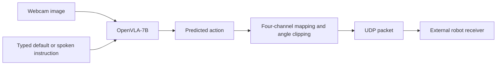

# VLA-ARM

**A vision-language-action control prototype connecting camera observations and spoken instructions to robot commands.**

This project integrates the pretrained **OpenVLA-7B** model with a webcam, speech input, and a UDP client. It explores the engineering path from an image and a language instruction to action prediction and a four-channel command interface.

`Python` · `PyTorch` · `Hugging Face Transformers` · `OpenVLA` · `OpenCV` · `UDP`

[Control client](https://github.com/sanjaiiv04/VLA-ARM/blob/master/pc_control.py) · [Inference check](https://github.com/sanjaiiv04/VLA-ARM/blob/master/test.py) · [OpenVLA upstream](https://github.com/openvla/openvla)

## System overview



The repository contains the **PC-side client**. A compatible robot receiver and its hardware-control implementation must be supplied separately.

### Implemented components

- **Image-conditioned inference:** capture webcam frames, convert them to RGB, and combine them with a task instruction for OpenVLA.
- **Voice input:** press `V` to record a short instruction and transcribe it through SpeechRecognition's Google recognition service.
- **Action adaptation:** select the first four predicted action values, clip them to `[-1, 1]`, and map them around configurable neutral angles using joint directions and angular ranges.
- **UDP transport:** serialize four target values as network-order floats and send them to the configured receiver.
- **Operator controls:** display the current prompt and running state in an OpenCV window, with pause/resume and quit controls.
- **Separate perception diagnostic:** locate the largest qualifying red region in a saved image using HSV masks, morphology, and contour geometry.

## Perception diagnostic


*Output saved by the separate OpenCV color-detection script. This diagnostic is not connected to the OpenVLA control loop.*

The detector combines two HSV ranges to handle red's hue wraparound, applies morphological opening and closing, and selects the largest contour above a 300-pixel area threshold. It reports the bounding box, centroid, and area, then saves an annotated image.

## Repository guide

- [`pc_control.py`](https://github.com/sanjaiiv04/VLA-ARM/blob/master/pc_control.py) — live webcam inference, voice input, action mapping, and UDP transmission.
- [`test.py`](https://github.com/sanjaiiv04/VLA-ARM/blob/master/test.py) — a single-image inference check that prints predicted actions without sending robot commands.
- [`detect_red_cube.py`](https://github.com/sanjaiiv04/VLA-ARM/blob/master/detect_red_cube.py) — standalone HSV-based red-region detection.
- [`images/`](https://github.com/sanjaiiv04/VLA-ARM/tree/master/images) — sample input and annotated output.

The tracked `openvla` entry is a Git submodule reference without a configured submodule URL in this checkout. Use the upstream OpenVLA instructions linked below to establish the model environment.

## Setup

### 1. Obtain the project

```bash
git clone https://github.com/sanjaiiv04/VLA-ARM.git
cd VLA-ARM
```

### 2. Configure the inference environment

Follow the official [OpenVLA inference setup](https://github.com/openvla/openvla#getting-started) for its compatible PyTorch, Transformers, and supporting dependencies. The [upstream installation notes](https://github.com/openvla/openvla#installation) document version constraints; this repository does not provide a pinned environment.

The local scripts also use **OpenCV, NumPy, Pillow, and SpeechRecognition**. Microphone capture requires **PyAudio** and a working audio backend. Install missing packages inside the same environment:

```bash
python -m pip install opencv-python numpy pillow SpeechRecognition PyAudio
```

Model weights are loaded from `openvla/openvla-7b` through Hugging Face. Initial loading requires a network connection and enough memory for the model. The control client selects CUDA with bfloat16 when available and otherwise requests CPU execution with float32; CPU performance is not benchmarked here.

### 3. Inspect an image without transmitting commands

In `test.py`, replace the hardcoded `image_path` with your local path to `images/test_scene.jpg`, then run:

```bash
python test.py
```

This script prints CUDA availability and the predicted action. It requests bfloat16 even on its CPU branch, so CPU compatibility requires checking or adapting the dtype for your environment.

For the standalone color diagnostic, update `IMAGE_PATH` in `detect_red_cube.py` and run:

```bash
python detect_red_cube.py
```

The detector opens image and mask windows and writes `test_scene_annotated.jpg` beside the input image. Press a key in the OpenCV window to close it.

### 4. Configure the control client

Edit these constants in `pc_control.py` for your system:

- `PI_IP`, `PI_PORT` — receiver address and UDP port.
- `CAM_ID` — webcam device index.
- `UNNORM_KEY` — action unnormalization statistics; currently `bridge_orig`.
- `FPS_LIMIT` — inference scheduling gate; currently configured to 10.
- `NEUTRAL`, `JOINT_DIR`, `RANGE_DEG`, `LIMITS` — joint mapping and angle bounds.

**The current client starts sending commands as soon as inference begins.** Validate the action mapping and receiver behavior before enabling physical motion. Pressing Space stops new transmissions; it does not send a stop command to the receiver.

```bash
python pc_control.py
```

With the OpenCV window focused:

- **Space:** pause or resume inference and transmission.
- **V:** record a spoken instruction, with a four-second phrase limit.
- **Q:** exit and release the camera and socket.

## Command interface

Each datagram is produced by `struct.pack("!4f", *targets)`: **16 bytes containing four big-endian, 32-bit floating-point target angles**. The receiver must use the same channel order and units.

The mapping takes the first four model outputs and applies:

```text
target = neutral + joint_direction × clipped_action × angular_range
target = clip(target, lower_angle_limit, upper_angle_limit)
```

This is a prototype mapping. OpenVLA's output is a task-space action representation; selecting four components and mapping them to joint angles does not establish a calibrated controller for a new robot embodiment.

## Scope & current limitations

- **Integration prototype:** the checked-in scripts load the pretrained model; no fine-tuning pipeline or task-success benchmark is included.
- **External hardware code:** the robot receiver, servo drivers, and hardware calibration procedure are absent from this repository.
- **Timing:** `FPS_LIMIT = 10` is a scheduling setting, not a measured inference rate. The synchronous loop's throughput depends on inference and other blocking work.
- **Transport:** UDP transmission has no acknowledgement, feedback channel, or receiver watchdog implementation here.
- **Perception:** the red-region detector uses color segmentation, not learned object detection or 3D localization.
- **Portability:** image paths and configuration are edited in source; the scripts were written around a Windows development setup.

## Possible next steps

Publish the receiver and hardware configuration, replace the heuristic action mapping with an embodiment-aware controller, add a dry-run mode and receiver watchdog, pin the environment, and record task-success and latency measurements. These are proposed extensions to the checked-in prototype.

## Acknowledgement

This project uses the pretrained [OpenVLA model](https://github.com/openvla/openvla). Model development and pretraining belong to the upstream authors; this repository focuses on the local control integration and perception diagnostic.
